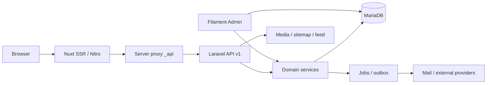

# Kiến trúc hiện hành — Nuxt + Laravel

Source local 5c35860f, 2026-11-26. Không dùng mô hình PHP server-rendered/administrator cũ.

| Layer | Source sở hữu |
|---|---|
| Public pages / UI | [frontend/app/pages](../../frontend/app/pages), [components](../../frontend/app/components) |
| State/requests | [composables](../../frontend/app/composables), [Nitro routes](../../frontend/server/routes), [contracts](../../frontend/shared/contracts) |
| API | [routes/api.php](../../backend/routes/api.php), [controllers](../../backend/app/Http/Controllers/Api/V1) |
| Business rules | [Domain](../../backend/app/Domain) |
| Admin | [Filament](../../backend/app/Filament), [AdminPanelProvider](../../backend/app/Providers/Filament/AdminPanelProvider.php) |
| Persistence | [Models](../../backend/app/Models), [migrations](../../backend/database/migrations) |
| Deploy | [deploy/laravel13](../../deploy/laravel13) |

Một quy tắc nghiệp vụ phải có owner rõ ràng; không nhân bản giá, trạng thái đơn hoặc điều kiện thanh toán trong UI. Khi đổi payload, kiểm cả controller, Nitro contract và consumer. Khi sửa Admin, xem service và audit log, không chỉ layout resource. [Request flow](request-flow.md), [dependency map](dependency-map.md), [sổ tay](../SO-TAY-CHU-PROJECT.md).

Lịch sử PHP trước cutover: git show 5c35860f:docs/01-architecture/overview.md.
