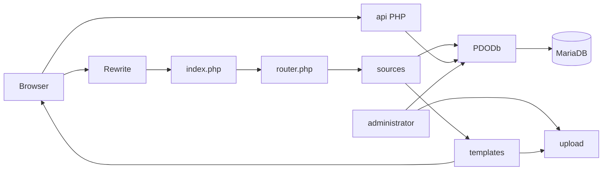

# Architecture

Monolith PHP server-rendered và CMS dùng chung MariaDB/filesystem.

Không có service/repository layer riêng; query/business logic nằm trong source/helper/admin source. Hướng nâng giao diện an toàn: giữ routing/source/data/admin, port UI vào template/assets mới theo từng route.

Ownership: `libraries/class/` là shared services; `sources/` storefront handlers; `templates/` views; `api/` AJAX; `administrator/` CMS; `upload/` persistent; `thumbs/`/`caches/` derived.
